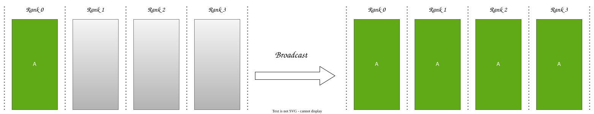
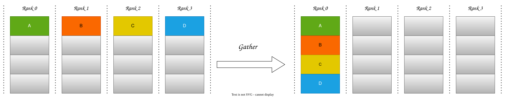
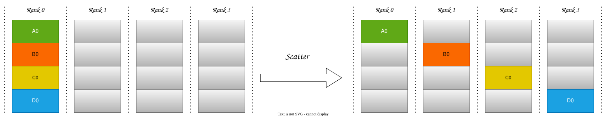
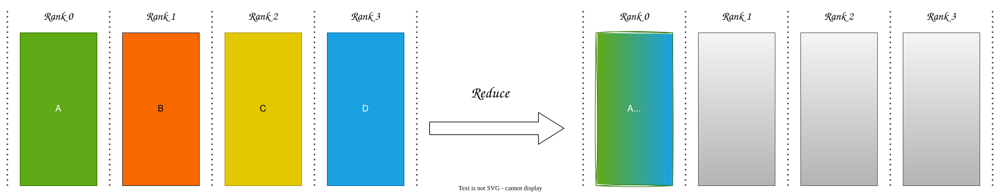
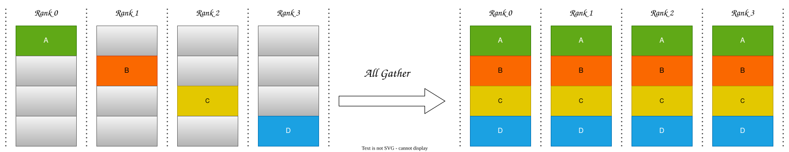
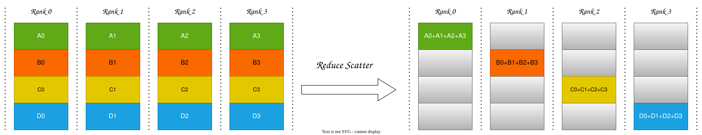
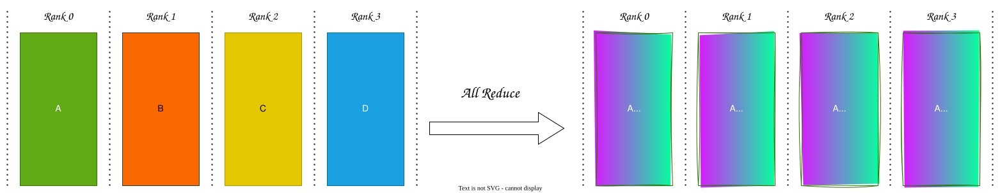
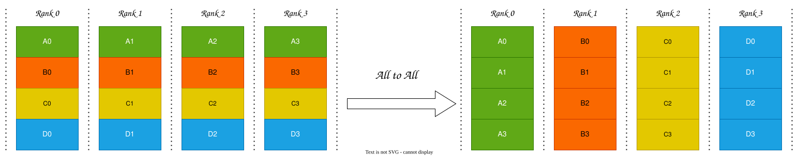

# 一对多、多对一

## Broadcast

- broadcast 是一个rank把自己的数据发送给其它rank

## Gather

- 将多个rank的数据收集到一个rank

## Scatter

- 将一个rank的数据平均划分，散布到其它rank

## Reduce

- 把多个rank的数据，规约到一个rank上。规约就是指经过计算，聚合在一起。
- 规约计算有：求和、求最小值、乘积等

# 多对多

## All Gather

- 每个rank都收集所有的rank的数据
- All Gather = Gather + Broadcast

## Reduce Scatter

- 数据按照rank平均切分，每个rank对自己划分的数据进行规约操作。
- Reduce Scatter = Reduce + Scatter

## All Reduce

- 在每一个rank都对所有数据进行规约操作。
- All Reduce = Reduce + Broadcast
- All Reduce = Reduce Scatter + All Gather
- All Reduce 操作是集合通信中最重要的操作。
- 一般情况，采用Reduce Scatter + All Gather。这通常是基于性能考虑，充分利用GPU的计算资源和带宽资源。

## All to All

- 看起来像矩阵的转置

