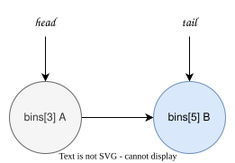
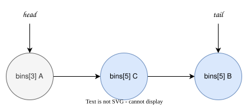
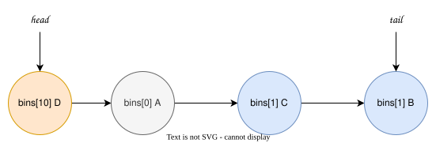

## 1. ncclTaskCollSorter简介

ncclTaskCollSorter 是对所要进行的集合通信操作的task，进行排序，按照数据side的大小，从大到小进行排序，形成一个task队列。以便后续按照这个队列进行处理这些task。

这种排序并不是严格按照size进行降序 排序，而是区分按照size大小划分区间，在同一区间的认为是相同的size。这是一种桶排序。


其实现代码如下：

```cpp
////////////////////////////////////////////////////////////////////////////////
// Roughly sorts ncclTaskColl's by their size descending. This structure is
// self-referential, meaning that pointers it contains internally may point
// into the structure itself. This means that it is NOT memcpy-moveable:

struct ncclTaskCollSorter {
  static constexpr int UnitLog2 = 10; // 1K
  static constexpr size_t UnitSize = 1<<UnitLog2;
  static constexpr int MaxLog2 = 30; // 1GB
  static constexpr size_t MaxSize = 1ull<<MaxLog2;
  // Number of bins between powers of 2. For 4 bins, the worst case out-of-order
  // relative magnitude is (5/4)-1 = 25%
  static constexpr int BitsPerPow2 = 2;
  static constexpr int BinsPerPow2 = 1<<BitsPerPow2;
  static constexpr int BinCount = 1 + (MaxLog2-UnitLog2)*BinsPerPow2;

  struct ncclTaskColl* head;
  struct ncclTaskColl* tail;
  // Least bin such that it and all above are empty.
  int binEdge;
  // Pointer to the pointer to this bin's head node which is either the
  // previous node's `next` field or `head`.
  struct ncclTaskColl** bins[BinCount];
};

inline void ncclTaskCollSorterInsert(
    struct ncclTaskCollSorter* me, struct ncclTaskColl* x, size_t size
  ) {
  constexpr int UnitLog2 = ncclTaskCollSorter::UnitLog2;
  constexpr size_t MaxSize = ncclTaskCollSorter::MaxSize;
  constexpr int BitsPerPow2 = ncclTaskCollSorter::BitsPerPow2;
  constexpr int BinCount = ncclTaskCollSorter::BinCount;
  int bin = u32fpEncode(std::min(MaxSize, size)>>UnitLog2, BitsPerPow2);
  bin = BinCount-1 - bin; // descending bin

  if (me->bins[bin] == nullptr) {
    if (me->binEdge <= bin) {
      me->binEdge = bin+1;
      me->bins[bin] = me->tail ? &me->tail->next : &me->head;
      me->tail = x;
    } else {
      // Find successor non-empty bin after this one.
      int succ = bin+1;
      while (me->bins[succ] == nullptr) succ++;
      // What was our successor's head's previous is now our head's previous.
      me->bins[bin] = me->bins[succ];
      // The first node we insert is our tail, so that becomes our successor's
      // head's new previous.
      me->bins[succ] = &x->next;
    }
  }
  // Push a new head for this bin.
  x->next = *me->bins[bin];
  *me->bins[bin] = x;
}

inline bool ncclTaskCollSorterEmpty(struct ncclTaskCollSorter* me) {
  return me->head == nullptr;
}

// Reset sorter and return sorted linked list of its coll tasks.
inline struct ncclTaskColl* ncclTaskCollSorterDequeueAll(struct ncclTaskCollSorter* me) {
  struct ncclTaskColl* head = me->head;
  if (head != nullptr) memset(me, 0, sizeof(*me));
  return head;
}

////////////////////////////////////////////////////////////////////////////////
```

|   var    |      indication       | remark            |
| :------: | :-------------------: | :---------------- |
| UnitLog2 | Unit Logarithm base 2 | 单位的 2 进制对数 |
| UnitSize | Unit Size | 由UnitLog2计算得到的实际基础单位大小| 
| MaxLog2 | Maximum Logarithm base 2 | 定义排序器支持的 “最大尺寸” 对应的 2 进制对数 |
| MaxSize | Maximum Size | 由MaxLog2计算得到的实际最大尺寸 |
|BitsPerPow2| Bits Per Power of 2 | 定义在 “每个 2 的幂区间” 内，用于细分桶的比特位数 |
| BinsPerPow2 | Bins Per Power of 2 | 每个 “2 的幂区间” 内包含的桶数量。
| BinCount | Bin Count | 排序器中桶的总数量。| 


## 2. 算法

- 本质是一个有序的单链表，链表是按照size从大到小排序的，这个排序不是严格的。
- 排序的方法是桶排序，按照size的区间划分为了81个桶，按照所属的桶进行排序，桶内不再进行排序。对于同一个桶，最新插入的节点排在最前边，即最靠近head。


## 3. 咱们举一个例子说明这个算法的过程


### 3.1. 初始化状态

- head = nullptr
- tail = nullptr
- binEdge = 0

### 3.2. 插入一个节点 A，假设bin是3

过程：
- binEdge = 4
- bins[3] = &head 这是因为目前tail是nullptr
- tail = A
- "A->next = *bins[bin] = *bins[3] = *(&head) = nullptr"
- *bins[bin] = A, 即 *bins[3] = *(&head) = A
结果状态：
- head = A
- tail = A
- binEdge = 4
- bins[3] = &head


### 3.3. 再插入一个节点B, bin是5

过程
- binEdge = 6
- bins[5] = &tail->next = &A->next
- tail = B
- B->next = *bins[bin] = *bins[5] = *(&A->next) = nullptr
- *bins[bin] = *bins[5] = *(&A->next) = A->next = B, 即A->next = B;

结果：
- head = A
- tail = B
- binEdge = 6
- bins[3] = &head
- bins[5] = &A->next



### 3.4. 再插入一个节点C, bin还是5

过程
- C->next = *bins[5] = *(&A->next) = A->next = B, 即C->next = B
- *bins[bin] = *bins[5] = *(&A->next) = A->next = C

结果：
- head = A
- tail = B
- binEdge = 6
- bins[3] = &head
- bins[5] = &A->next



###. 再插入一个节点D, bin是1

过程
- succ = bin + 1 = 2
- 经过while循环，succ = 3
- bins[bin] = bins[succ], 即bins[1] = bins[3], 即 bins[1] = &head
- bins[succ] = &D->next, 即bins[3] = &D->next
- D->next = *bins[1] 即 *(&head) 即 head 即 A, 即D->next = A
- *bins[bin] 即 *bins[1] 即 *(&head) 即,  head = D

结果：
- head = D
- tail = B
- binEdge = 6
- bins[1] = &head
- bins[3] = &D->next
- bins[5] = &A->next


