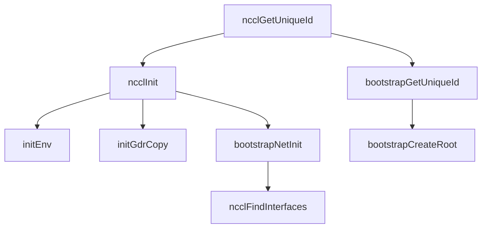
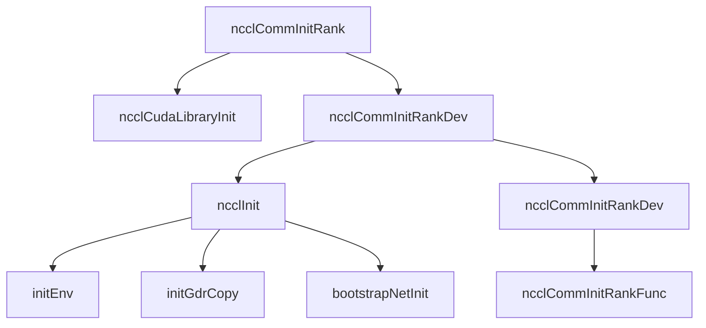
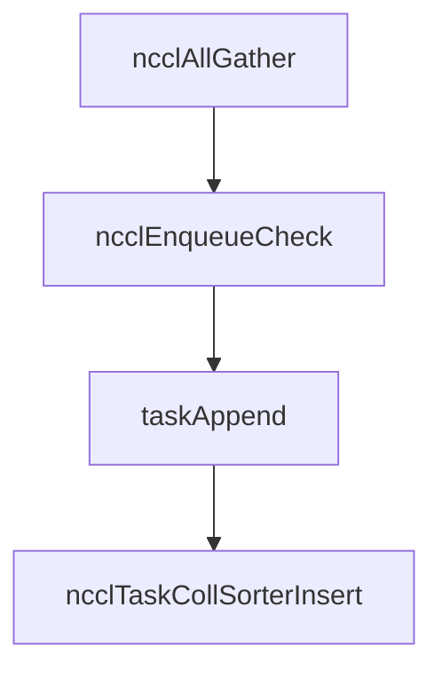

每个函数的作用

| function            | mark                                  |
| :------------------ | :------------------------------------ |
| ncclCudaLibraryInit | 检查CUDA 版本，是否符合当前NCCL的要求 |


使用到的线程：

- "NCCL BootstrapR"


# temp

在 `ncclComm` 中有一个字段是`struct ncclKernelPlanner planner;`，维护着需要用到的队列。


```cpp
struct ncclKernelPlanner {
  //////////////////////////////////////////////////////////////////////////////
  // State for accumulating tasks between ncclGroupStart/End()
  //////////////////////////////////////////////////////////////////////////////

  struct Peer {
    bool sendSeen, recvSeen;
    struct ncclIntruQueue<struct ncclTaskP2p, &ncclTaskP2p::next> sendQueue;
    struct ncclIntruQueue<struct ncclTaskP2p, &ncclTaskP2p::next> recvQueue;
  };
  struct ncclTaskCollSorter collSorter;
  struct Peer* peers/*[nRanks]*/;
  int nTasksColl, nTasksP2p;
  bool persistent;
  bool isSymColl;

  // The list of user streams aggregated over all tasks present.
  struct ncclCudaStreamList* streams;
  // The most recent user stream. Ignored if streams==nullptr
  cudaStream_t streamRecent;
  // The graph capturing all user streams or invalid if none. Thus we restrict the
  // user that all streams must be captured in the same graph or not captured
  // at all. Technically we could probably relax this, but that would mean
  // collecting a different `ncclTasks` per graph and one for non-graph.
  struct ncclCudaGraph capturingGraph;

  //////////////////////////////////////////////////////////////////////////////
  // Lists of tasks to be assembled into plans.
  //////////////////////////////////////////////////////////////////////////////

  struct ncclIntruQueue<struct ncclTaskColl, &ncclTaskColl::next> collTaskQueue;
  struct ncclIntruQueue<struct ncclWorkList, &ncclWorkList::next> collWorkQueue;
  struct ncclIntruQueue<struct ncclWorkList, &ncclWorkList::next> tmpCollWorkQueue;
  struct ncclIntruQueue<struct ncclCommCallback, &ncclCommCallback::next> collCleanupQueue;

  //////////////////////////////////////////////////////////////////////////////
  // State for building current (Work-In-Progress) plan:
  //////////////////////////////////////////////////////////////////////////////

  struct WipPlan {
    struct Channel {
      struct {
        int workBytes; // Sum size of work metadata referenced by this batch.
        int nP2ps; // Number of p2p works in this batch
        int p2pRounds[NCCL_MAX_DEV_WORK_P2P_PER_BATCH]; // which rounds are present in this batch.
      } wipBatch; // work-in-progress batch which will be next tail of workBatchQueue
      int nWorkBatchesP2p; // number of p2p batches for this channel.
      struct ncclIntruQueue<struct ncclWorkBatchList, &ncclWorkBatchList::next> workBatchQueue;
      struct ncclIntruQueue<struct ncclProxyOp, &ncclProxyOp::enqNext> proxyOpQueue;
    } channels[MAXCHANNELS];
  } wipPlan;

  //////////////////////////////////////////////////////////////////////////////
  // State for launching built plans:
  //////////////////////////////////////////////////////////////////////////////

  // List of kernel plans built form tasks.
  struct ncclIntruQueue<struct ncclKernelPlan, &ncclKernelPlan::next> planQueue;
  // First of the unlaunched kernels in `planQueue`
  struct ncclKernelPlan* unlaunchedPlansHead;
};
```



