## 1. 交换机配置

### 1.1. 全局配置

```sh
priority-flow-control poolID 0 headroom 9928         设置服务池的可使用的headroom
priority-flow-control deadlock cos 5 interval 10         配置PFC死锁检测的周期
priority-flow-control deadlock precision high           PFC死锁检测定时器的精度
buffer egress cell queue 6 shared ratio 100             6队列的Egress动态Alpha值
buffer egress cell queue 5 shared ratio 100             5队列的Egress动态Alpha值
buffer apply
```

### 1.2. 接口配置

```sh
interface FourHundredGigE1/0/1
priority-flow-control enable                       # PFC使能
priority-flow-control deadlock enable              # PFC死锁使能
priority-flow-control no-drop dot1p 5              # 5队列开启PFC
priority-flow-control dot1p 5 headroom 125         # 队列headroom门限
priority-flow-control dot1p 5 reserved-buffer 17   # 队列预留buffer值
priority-flow-control dot1p 5 ingress-buffer dynamic 5  # PFC动态水线，静态static
priority-flow-control dot1p 5 ingress-threshold-offset 12      # 反压帧停止门限与触发门限间的偏移量


qos wred queue 5 drop-level 0 low-limit 2100 high-limit 5000 discard-probability 20   # ECN静态水线配置
qos wred queue 5 drop-level 1 low-limit 2100 high-limit 5000 discard-probability 20   # ECN静态水线配置
qos wred queue 5 drop-level 2 low-limit 2100 high-limit 5000 discard-probability 20  # ECN静态水线配置
qos wred queue 5 ecn                                                                  # ECN使能
qos wred queue 5 weighting-constant 0                                                # 平均队列长度
qos trust dscp                                                                       
qos wfq byte-count                                                                   # 配置队列调度权重
qos wfq ef group 1 byte-count 60                                                     # 配置队列调度权重
qos wfq cs6 group sp                                                                 # 配置队列加入SP组，采用严格优先级调度算法
qos wfq cs7 group sp                                                                 # 配置队列加入SP组，采用严格优先级调度算法
qos gts queue 6 cir 200000000 cbs 16000000   

```

### 1.3. Spine-Leaf 互联口配置

```sh
interface FourHundredGigE1/0/17
port link-mode route
priority-flow-control enable
priority-flow-control no-drop dot1p 5 pause-threshold ratio 5
priority-flow-control deadlock enable
flow-interval 5
ip address unnumbered interface LoopBack0
ospf network-type p2p
ospf 10 area 0.0.0.0
lldp management-address arp-learning
lldp tlv-enable basic-tlv management-address-tlv interface LoopBack0
undo mac-address static source-check enable
qos trust dscp
qos wfq byte-count
qos wfq ef group 1 byte-count 60
qos wfq cs6 group sp
qos wfq cs7 group sp
qos wred queue 5 drop-level 0 low-limit 2100 high-limit 5000 discard-probability 20
qos wred queue 5 drop-level 1 low-limit 2100 high-limit 5000 discard-probability 20
qos wred queue 5 drop-level 2 low-limit 2100 high-limit 5000 discard-probability 20
qos wred queue 5 ecn
qos wred queue 5 weighting-constant 0
qos gts queue 6 cir 200000000 cbs 16000000
```

### 1.4. 水线调优

#### 1.4.1. 观察是否丢包

##### 1.4.1.1. 查看接口是否有丢包
查看接口HundredGigE1/0/25丢弃报文的信息。
```sh
<Sysname> display packet-drop interface hundredgige 1/0/25
HundredGigE1/0/25:
  Packets dropped due to Fast Filter Processor (FFP): 0
  Packets dropped due to Egress Filter Processor (EFP):  : 0
  Packets dropped due to STP non-forwarding state: 0
  Packets dropped due to insufficient data buffer. Input dropped: 0 Output dropped: 0
  Packets of ECN marked: 0
  Packets of WRED droped: 0
```

##### 1.4.1.2. 出现数据缓冲区不足（insufficient data buffer）丢包处理

(1)     若出现Input dropped类型的丢包，可以增加端口Headroom缓存门限值的大小，建议按照当前配置值的倍数进行调整，直到不再出现Input dropped类型的丢包。例如：

```sh
# 配置Headroom缓存门限为982。
<sysname> system-view
[Sysname] interface hundredgige 1/0/25
[Sysname-HundredGigE1/0/25] priority-flow-control dot1p 5 headroom 982
```

如果调整至最大值仍然丢包，请排查服务器网卡是否支持和启用PFC功能。

(2)     若出现Output dropped类型的丢包，需要检查队列出方向最大共享区域占用比是否配置为100%和是否执行了buffer apply命令。例如：

```sh
# 配置队列5在cell资源中的最大共享缓存占用比为100%并应用配置。
<sysname> system-view
[Sysname] buffer egress cell queue 5 shared ratio 100
[Sysname] buffer apply
```

如果出方向队列配置为100%后仍然有Output dropped类型的丢包，则可能存在组网或配置问题，请排查组网和配置问题或联系技术支持。

##### 1.4.1.3. 出现WRED类型（WRED droped）丢包处理

(1)     若出现WRED droped丢包，请查看RoCE队列的ECN功能是否已开启。

```sh
<Sysname> display qos wred table
Table name: 1
Table type: Queue based WRED
QID   gmin  gmax  gprob  ymin  ymax  yprob  rmin  rmax  rprob  exponent  ECN
----------------------------------------------------------------------------

0     100   1000  10      100   1000  10      100   1000  10      9         N
1     100   1000  10      100   1000  10      100   1000  10      9         N
2     100   1000  10      100   1000  10      100   1000  10      9         N
3     100   1000  10      100   1000  10      100   1000  10      9         N
4     100   1000  10      100   1000  10      100   1000  10      9         N
5     100   1000  10      100   1000  10      100   1000  10      9         N
6     100   1000  10      100   1000  10      100   1000  10      9         N
7     100   1000  10      100   1000  10      100   1000  10      9         N
```

(2)     若RoCE队列的ECN功能未开启（显示信息中ECN字段显示为N），则需要开启RoCE队列的ECN功能。

```sh
<Sysname> system-view
[Sysname] interface hundredgige 1/0/25
[Sysname-HundredGigE1/0/25] qos wred queue 5 ecn
```

(3)     若RoCE队列的ECN功能开启后WRED类型的丢包继续增加，则需要查看服务器的RoCE队列报文是否携带ECN标志位。若未携带，请排查服务器网卡是否启用了PFC和ECN功能。

(4)     如果仍然存在丢包，请联系技术支持。

#### 1.4.2. 观察时延是否满足需求

为了满足时延需求，在不丢包的情况下，可以调整ECN和PFC的部分参数，进而降低时延。调整时延会影响吞吐，可以认为的原则是：在拥塞网络环境下，占用的buffer越小，时延越低，吞吐量较小；占用的buffer越大，时延越大，吞吐量较大。请根据具体组网需求平衡时延和吞吐的关系。

不拥塞网络环境下，PFC和ECN等功能不生效。触发ECN、PFC后，报文转发降速。调整的原则是尽量在低buffer占用，不丢包的情况下触发ECN和PFC。建议优先调整ECN。

另外需要注意的是，参数调整还需要考虑服务器网卡的支持情况，包括网卡对PFC、ECN报文的响应机制，是否有PFC、ECN相关的特殊能力。例如有些网卡支持自降速功能（时延大的情况自动降速）。此时如果我们想要加大吞吐，但是调整后加大了时延，服务器自降速了，反而起到了和预期相反的效果。建议调整前先查阅服务器的相关资料，了解服务器网卡PFC、ECN功能的支持情况和相关功能，并在调整过程中实际验证调整是否合适。

##### 1.4.2.1. 调整ECN
可以调整WRED表中各队列的如下参数，控制时延与吞吐量：

- Low-limit（队列平均长度的下限）和high-limit（队列平均长度的上限）：通过调低low-limit和high-limit值，可以更快的触发ECN标记，使时延更低，但可能会影响吞吐量。

- Weighting-constan（计算平均队列长度的指数）：表示的是队列深度的计算方式，为0表示实时队列深度，对ECN的标记会更灵敏。平均队列长度的指数越大，计算平均队列长度时对队列的实时变化越不敏感。建议保持推荐值。仅在完成其他调整项后仍然无效的情况下再尝试调整。

- discard-probability（丢弃概率）：在使能了ECN后，代表的是标记概率，该值越大，表示在上下限门限之间被标记的报文数越多。建议保持推荐值，仅在完成其他调整项后仍然无效的情况下再尝试调整。可以按照当前值20%的幅度进行调整。

配置举例：

```sh
# 配置队列5的WRED参数：队列平均长度的下限为800，队列平均长度的上限为1800。
<Sysname> system-view
[Sysname] qos wred queue table queue-table1
[Sysname-wred-table-queue-table1] queue 5 drop-level 0 low-limit 800 high-limit 1800
[Sysname-wred-table-queue-table1] queue 5 drop-level 1 low-limit 800 high-limit 1800
[Sysname-wred-table-queue-table1] queue 5 drop-level 2 low-limit 800 high-limit 1800
```


##### 1.4.2.2. 调整PFC

PFC是ECN后的一层屏障，保证设备不丢包。PFC一般不被触发，对时延影响不大，并且PFC门限调整过低会影响吞吐量，所以一般不建议调整。

但如果想进一步降低时延，可以尝试调整ingress-buffer参数（反压帧触发门限）。

注意： 需要注意的是，在设备有流量收发的情况下调整PFC门限会引起丢包。

(1)     减小ingress-buffer门限值，建议跟随WRED的high-limit门限进行调整（按当前值10%的幅度减小），但要保证该门限值大于WRED的high-limit门限值，保证设备优先触发ECN功能。

```sh
# 配置动态反压帧触发门限为4。
<sysname> system-view
[Sysname] interface hundredgige 1/0/25
[Sysname-HundredGigE1/0/25] priority-flow-control dot1p 5 ingress-buffer dynamic 4
```

(2)     调整完成后，可以通过命令行多次查看接口的PFC信息，尽量保证设备上PFC的收发数量较少，即不触发或偶尔触发PFC。如果多次查看发现存在PFC报文收发，则表示ingress-buffer值配置过低，建议回调。

```sh
# 显示接口的PFC信息。
<Sysname> display priority-flow-control interface
Conf -- Configured mode   Ne -- Negotiated mode   P -- Priority
Interface     Conf Ne  Dot1pList   P Recv       Sent       Inpps      Outpps
HGE1/0/25     Auto On  0,2-3,5-6   0 178         43         12         15
```

#### 1.4.3. AI ECN配置(选配)

分布式：
```sh
#
ai-service
 ai ai-ecn enable mode distributed         设置分布式使能                                              
 ai-ecn
  queue 5 enable                           使能ECN队列
#

集中式：
#
ai-service
 ai ai-ecn enable mode centralized        
 ai-ecn
  queue 5 enable
#
```

### 1.5. 会话分析相关（选配）

```sh
netanalysis rocev2 mode bidir
netanalysis rocev2 drop global
netanalysis rocev2 statistics global
netanalysis rocev2 ai-ecn enable
```

### 1.6. 信息上报相关（选配）

```sh
#
 buffer threshold alarm ingress enable
 buffer threshold alarm egress enable
 buffer threshold alarm headroom enable
 buffer usage threshold headroom slot 1 ratio 2
 buffer egress usage threshold slot 1 queue 5 ratio 1
 buffer ingress usage threshold slot 1 queue 5 ratio 1
#
```

Telemetry配置：

```sh
telemetry
 sensor-group sdn_grpc_1_0
  sensor path buffermonitor/portquedropevent
  sensor path buffermonitor/portqueoverrunevent
  sensor path netanalysis4/rocev2connectionevent
  sensor path netanalysis4/rocev2intfstatisticevent
  sensor path netanalysis4/rocev2statisticevent
 sensor-group sdn_grpc_1_60
  sensor path buffermonitor/bufferusages
  sensor path buffermonitor/commbufferusages
  sensor path buffermonitor/commheadroomusages
  sensor path buffermonitor/ecnandwredstatistics
  sensor path buffermonitor/egressdrops
  sensor path buffermonitor/ingressdrops
  sensor path buffermonitor/pfcspeeds
  sensor path buffermonitor/pfcstatistics
  sensor path buffermonitor/portqueconfigurations
  sensor path device/extphysicalentities
  sensor path device/physicalentities
  sensor path ifmgr/ethportstatistics
  sensor path ifmgr/interfaces
  sensor path lldp/lldpneighbors
  sensor path mqc/globalcategorypolicyaccount
  sensor path mqc/ifcategorypolicyaccount
  sensor path mqc/ifpolicyaccount
  sensor path pfc/pfcports/port
  sensor path pfc/pfcports/port/portnodrops/portnodrop
  sensor path pfc/portdeadlocks
  sensor path qos/interfaces/interface/input/queues/queue/state
  sensor path qstat/queuestat
  sensor path wred/dropparameter
  sensor path wred/ifapplytable
  sensor path wred/ifqueuewreds/ifqueuewred
  sensor path wred/ifqueuewreds/ifqueuewred/dropparameters/dropparameter
  sensor path wred/queueparameter
 sensor-group sdn_grpc_1_300
  sensor path acl/ipv4namedadvancerules
  sensor path mqc/rules
  sensor path route/ipv4routes
 sensor-group sdn_grpc_1_600
  sensor path ifmgr/ports
 sensor-group sdn_grpc_1_1800
  sensor path device/transceivers
 sensor-group sdn_grpc_1_3600
  sensor path device/base
 destination-group grp_TDTJA4BE6QIYFHVW4R64HLKBHU
  ipv4-address 212.0.136.81 port 50051 vpn-instance management_vpn
 subscription grp_TDTJA4BE6QIYFHVW4R64HLKBHU
  sensor-group sdn_grpc_1_0
  sensor-group sdn_grpc_1_1800 sample-interval 1800
  sensor-group sdn_grpc_1_300 sample-interval 300
  sensor-group sdn_grpc_1_3600 sample-interval 3600
  sensor-group sdn_grpc_1_60 sample-interval 60
  sensor-group sdn_grpc_1_600 sample-interval 600
  source-address 212.0.134.141
  destination-group grp_TDTJA4BE6QIYFHVW4R64HLKBHU
#
```

### 1.7. Spine-leaf 配置举例

- spine1.txt
- leaf1.txt

### 1.8. 控制器

网络设备自动化上线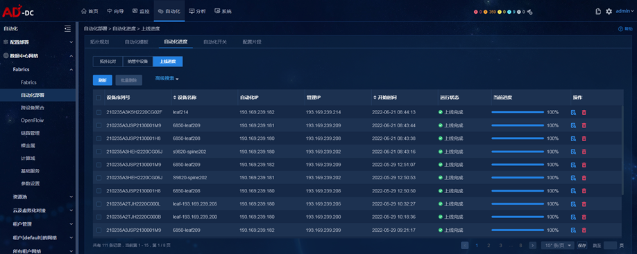

ROCE相关配置可通过控制器下发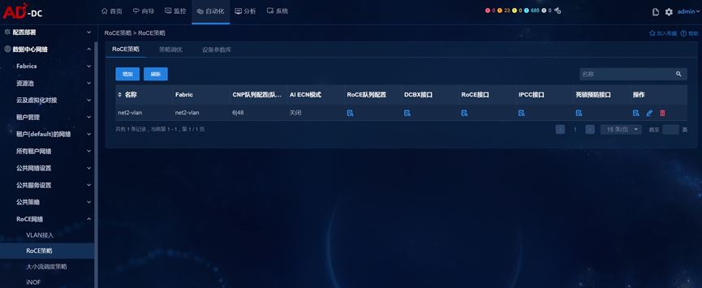

### 1.9. 分析器

可以准确的展示链路的端口、带宽、流速等信息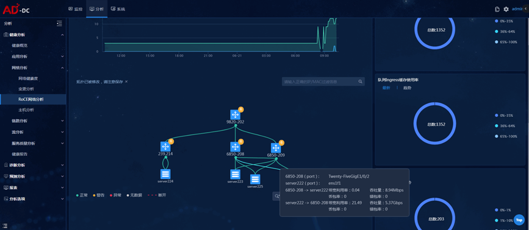

页面可正确展示会话信息，包括Sip、Dip、Sqp、Dqp信息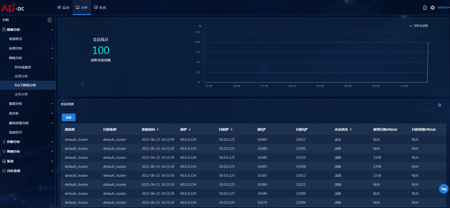

页面可正确展示流路径信息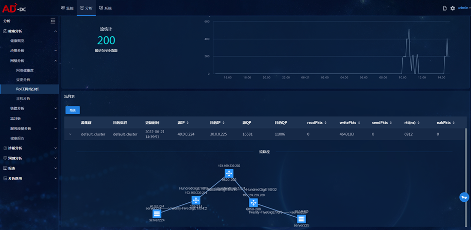

交换机端口占用情况：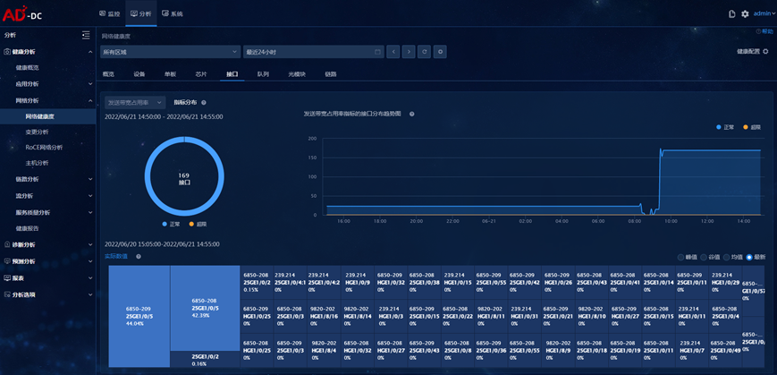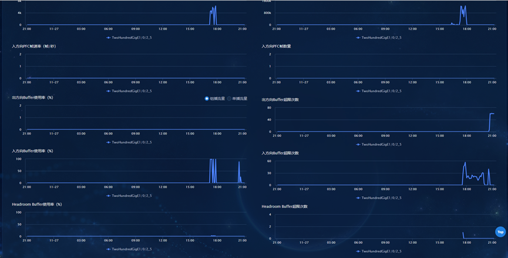

## 2. ROCE网卡预配置

### 2.1. 提前准备

（1）	首先需要在服务器上先安装对应的MLNX_OFED组件，之后再进行网卡配置。关于MLNX_OFED网卡驱动的下载、安装部署的详细过程，请参考nvidia官网《NVIDIA MLNX_OFED Documentation 》。
安装示例图如下：

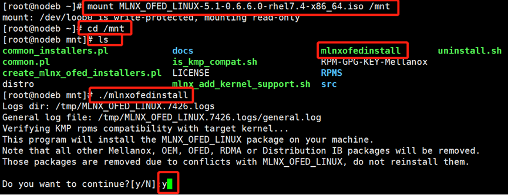

（2）	驱动安装完成后通过systemctl status openibd命令查看openibd服务是否开启，如果没有开启，可通过systemctl start openibd开启。
查看截图：

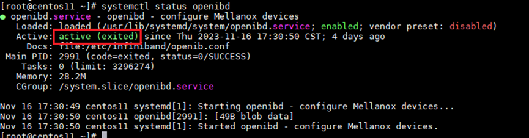

### 2.2. 配置网卡的RoCEv2配置

通过下列命令查看RoCE网卡信息，后续网卡的RoCE配置举例，我们以下图中的mlx5_2举例。

```sh
[root]# show_gids
```
结果显示信息如下：
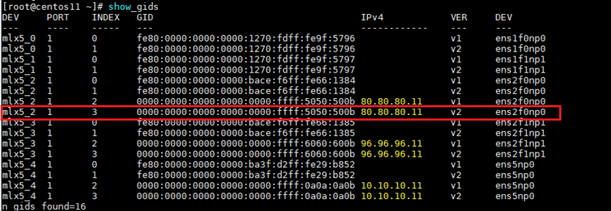

设置网卡的RoCE模式为V2。
```sh
[root]# cma_roce_mode -d mlx5_bond_0 -p 1 -m 2
```
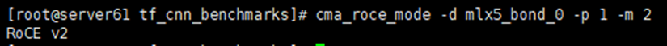

设置完成后，可通过抓包查看报文判断是否是ROCEv2报文，RoCEv2报文抓包截图示例如下：

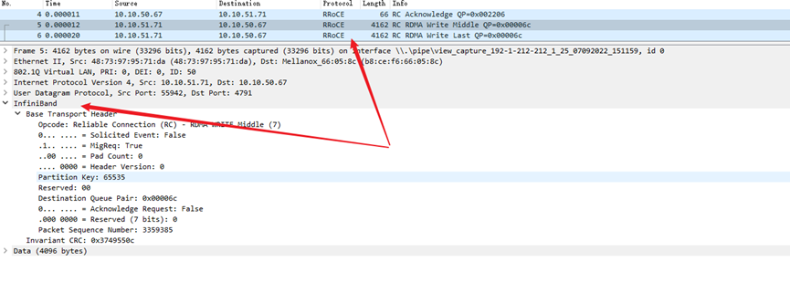

设置QOS信任模式为DSCP。
找到ens2f0np0所绑定的实网卡执行如下操作：
```sh
[root]# mlnx_qos -i  ens2f0np0 --trust=dscp
```
命令执行后，显示如下：
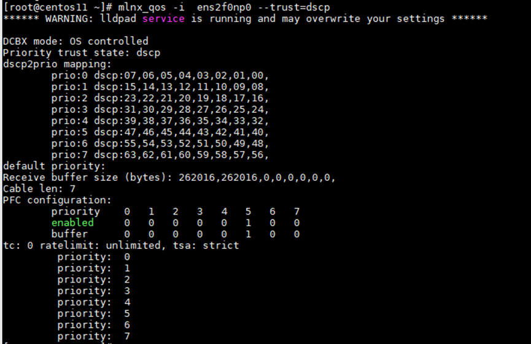

通过下列指令查看配置是否生效：
[root]# mlnx_qos -i  ens2f0np0  
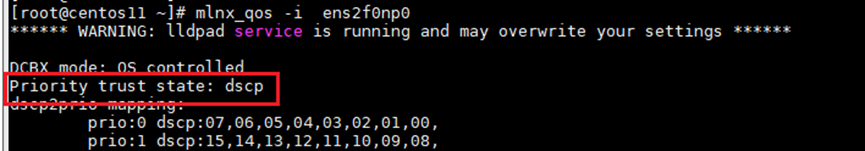

设置ToS值，此处举例，将网卡发出报文携带的ToS值为162（对应网卡队列5），关于ToS和DSCP值的映射关系，可参考《H3C QoS技术白皮书》。
```sh
[root]# cma_roce_tos -d mlx5_2 -t 162
[root]# echo 162  >  /sys/class/infiniband/mlx5_2/tc/1/traffic_class
```
可以通过下列指令查看TOS值设置是否成功。
```sh
[root]# cat /sys/class/infiniband/mlx5_2/tc/1/traffic_class
```


将CNP报文的优先级设置为6，对应DSCP优先级值为48。 Mellanox网卡对CNP优先级和DSCP的默认值已经是6和48了，因此该步骤可不用配置。
可以通过如下命令查看确认：
```sh
[root@server61 ~]# more /sys/class/net/ens2f0np0/ecn/roce_np/cnp_dscp 
[root@server61 ~]# more /sys/class/net/ens2f0np0/ecn/roce_np/cnp_802p_prio
```
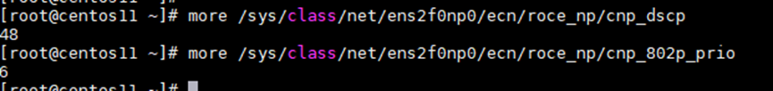

如果当前网卡的CNP优先级和DSCP并不是上述的默认值，通过如下命令修改：
```sh
[root]# echo 6 > /sys/class/net/ens3f0/ecn/roce_np/cnp_802p_prio
[root]# echo 48 > /sys/class/net/ens3f0/ecn/roce_np/cnp_dscp
```
使能网卡的ECN使能标记功能，命令如下。
```sh
[root]# sysctl -w net.ipv4.tcp_ecn=1
```
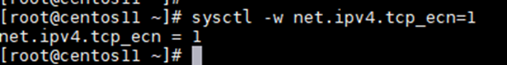
通过如下命令查看内核参数值：


设置完成后，可通过抓包查看报文判断ECN标记使能成功。抓包举例如下图所示：
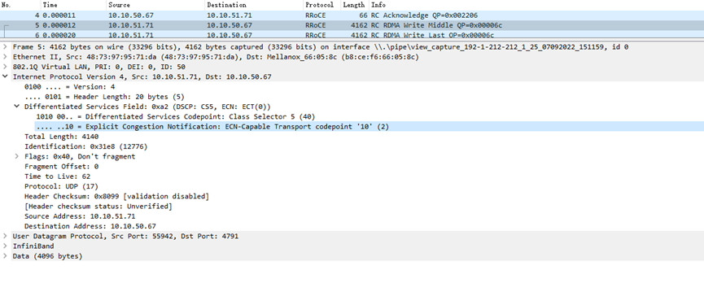

【可选】开启Mellanox网卡的DCBX功能设置。若服务器需要开启DCBX功能，请参考如下配置举例。

- Mellanox网卡开启DCBX配置.txt

使能接口队列的PFC功能。通过如下命令设置网卡队列5开启PFC功能。如果网卡已开启DCBX功能，则检查5队列是否已使能PFC功能，若已使能则本步骤可不配置。
```sh
 [root]# mlnx_qos -i ens2f0np0 --pfc=0,0,0,0,0,1,0,0
```
查询设置结果：
```sh
[root]# mlnx_qos -i ens2f0np0
```

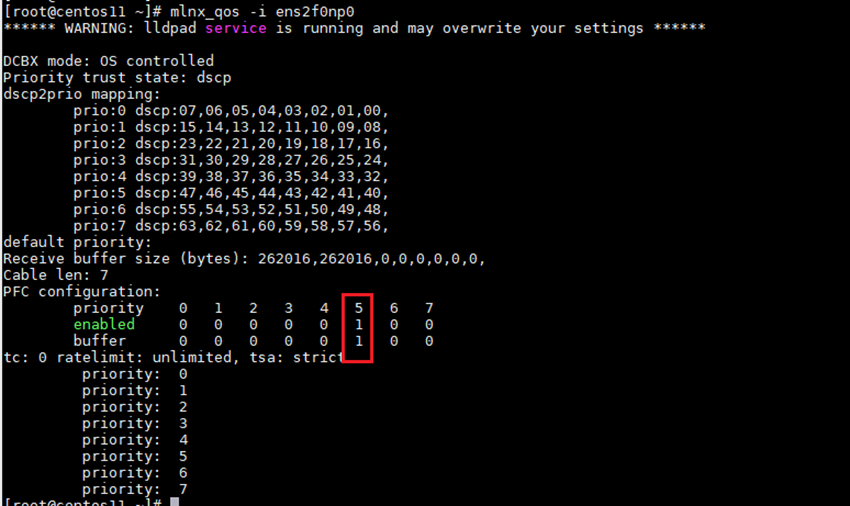

网卡的关于RoCEv2的配置完整配置如下。

**注意**：网卡相关配置服务器重启后不会生效，建议将网卡的完整配置添加到rc.local配置文件中，形成启动自动加载。
```sh
[root]# vi /etc/rc.local
```

## 3. 附录：服务器多网卡配置策略路由配置

当业务服务器为多链路三层上行时，建议通过策略路由方式来保证服务器的业务流量的来回路径一致。
此处以服务器有2网口三层上行到Leaf交换机来配置服务器的策略路由来做示例：

```sh
#配置路由表
echo "101 t1" >> /etc/iproute2/rt_tables
echo "102 t2" >> /etc/iproute2/rt_tables
#配置策略路由，当流量原地址为从192.168.1.3时，走策略路由表t1。
#注意：这192.168.1.3是ens2f0np0的IP地址
[root]# ip route add default via 192.168.1.254 dev ens2f0np0 table t1
[root]# ip rule add from 192.168.1.3 table t1
#配置策略路由，当流量原地址为从192.168.2.3时，走策略路由表t2。
#注意：这192.168.1.3是ens3f0np0的IP地址
[root]# ip route add default via 192.168.2.254 dev ens3f0np0 table t2
[root]# ip rule add from 192.168.2.3 table t2
注意：网卡相关配置服务器重启后不会生效，建议将网卡的完整配置添加到rc.local配置文件中，形成启动自动加载。
[root]# vi /etc/rc.local
```

