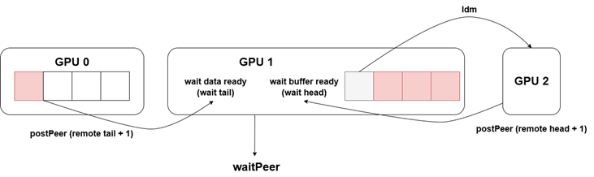

# SCCL sync between multi gpus

## SPC sync
适用跨机多的时候的方案。latency 小

remote_tail, remote_head are 控制变量 （控制发buffer chunk 的节奏） 存在HBM 上。



```cpp
template <int Recv, int Send>
inline __device__ void waitPeer(int64_t sendSize)
{
    const bool isSendNotRecv = Send && (flags & RoleWaitSend);
    /*
        For send: *localStep is my send step; *head is proxy send head
        For recv: *localStep is my recv step; *head is proxy recv head
    */
    if (flags & (Recv * RoleWaitRecv | Send * RoleWaitSend)) {
        if (warp_thread_idx == 0) {
        int spins = 0;
        while (connStepCache + (isSendNotRecv ? spcSteps : 0) < step + 1) {
            connStepCache = *connStepPtr;
            if (checkAbort(spins)) {
            break;
            }
        }
        if (isSendNotRecv && sizesFifo) {
            *(sizesFifo + step % spcSteps) = sendSize;
        }
        ++step;
        }
        __syncwarp();
    }
}

template <int Recv, int Send> __device__ __forceinline__ void postPeer() {
    if (flags & (Recv * RolePostRecv | Send * RolePostSend)) {
        ++step;
        *(connStepPtr + warp_thread_idx) = step;
    }
}
```


## DMA sync

### GSE (lowest latency)
GSE(Global Sync Engine): 

```cpp
// function definition
suError_t sudrvStreamWaitGlobalSyncEvent(suStream_t stream,suGlobalSyncEvent_t gse,unsigned int count);
// function call
SUPAICHECK(sudrvStreamWaitGlobalSyncEvent(m_user_stream, getGse(),m_comm->localRanks - 1));
```

使用条件和限制：
1.	p2p直连或间接连接
2.	机间光互连，2机可用gse，4机不行
3.	每个gpu不能连续使用同一个gse
4.	gse最多创建64个

### GPU barrier（比GSE latency 稍大一些）

```cpp
SUPAICHECK(sudrvStreamWriteValue64(stream, step, 1,suStreamWriteValueAdd));
SUPAICHECK(sudrvStreamDeviceCompareWait(stream, tail,step, 0));
```

OCS 4机里无法使用sudrvStreamWriteValue64接口，改用`suMemcpyBroadcastAsyncWithGpuId`，延时增大。

debug：GPU barrier

### Host Node （CPU方案，latency 很大，很少用）


```cpp
void dmaPrimsSimpleHostBarrier(void *user_data) {
  HostNodeData *headers = (HostNodeData *)user_data;
  *headers->userData.self_header += 1;
  headers->userData.showSelf("dmaPrimsSimpleHostBarrier barried in");

  while (*headers->userData.self_header > *headers->userData.peer_header) {
  }

  headers->userData.showSelf("dmaPrimsSimpleHostBarrier barried out");
}
```
