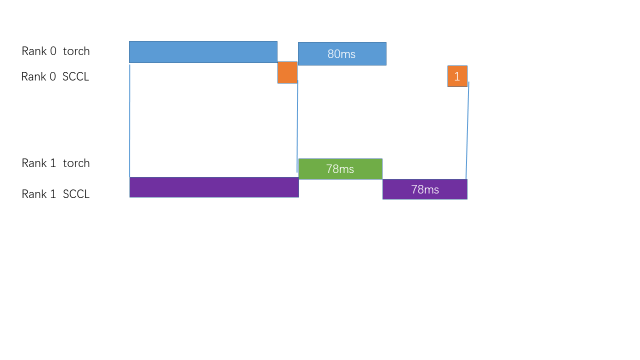

# 问题现象

“在两机8卡环境下，使用pp方案，rank0给rank1发送数据，rank1接收数据，在256并发，rank1接收的时间大概在400~700us之间，在380并发下，rank1接收时间到了80ms”

# 排查步骤：

## 确认环境信息：

1. 硬件：使用的是 BR166M，两机
2. 软件：使用的fullstack较老，使用的SCCL版本是25年6月份版本：fc8b0fcc

## 确认如何使用SCCL

1. 框架通过MPI，在每机启动了一个进程，这个进程又启动了8个线程，管理8个GPU，对应了SCCL的8个rank；
2. 两机两卡组成一个通信组，共8个通信组。
3. 一个通信组内：rank 0 通过SCCL的send 接口，向rank 1发送数据；rank 1通过SCCL的recv接口，接收来自rank 0的数据。
4. 那么可以确认一个通信组内，这个send和recv底层的通信是rdma。

## 确认专业术语：什么是256并发？什么是380并发？

1. 所谓的256并发指的是一次发送256个token,一个token是7168个BF16，size大小是：$256 \times 7168 \times 2 = 3.5MB$。同理380并发的数据大小是：$5.2MB$ 左右。
2. GDR的带宽，一般认为是$13GB/s$, 那么380并发，合理的时间应该在 400微妙，考虑到还有其它影响到带宽的因素，比如同步等，但是数量级应该在百微秒级。

380并发，合理的时间应该在百微妙级，那么80毫秒毫无疑问是一个明显不合理的时间。

## 时间打点
时间打点是调查通信时间异常的比较好的方式。

通过时间打点可以发现：

- SUCCL Send的时间比较合理，在1毫秒左右。
- SUCCL Recv的时间比较异常，在80毫秒左右，是一个异常的数字。

这说明，SUCCL的Recv 一直在等待另一个rank的Recv。如果SUCCL的Send和Recv是同时发生的，那么通信时间将会在1ms左右。

接下来就要找到SUCCL的Recv为什么会等待这么长时间？

根据和框架的同事讨论，可以画出如下的示意图：

- Rank 1的recv等了接近78毫秒，但是Rank 0的计算只花费了80ms

根据以上分析，怀疑计算部分肯定还有其它耗时的程序，导致了SCCL Recv接近78毫秒的等待。

通过进一步在框架的代码打点发现 是MPI_Ibcast比较耗时。

# 问题解决

- 把MPI_Ibcast 非阻塞发送后，的等待MPI_wait放到SCCL Send之后，这样子SUCCL Recv和Send接近同时开始，可以同时结束。

