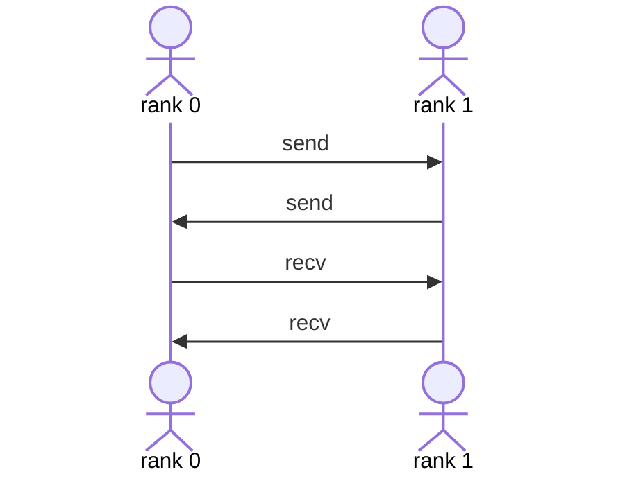

场景如下：

- 每个GPU一个进程
- 两个进程：rank 0, rank 1
- rank 0 和rank 1同时调用send 发送给对方，然后同时调用recv接收对方的数据
- 



结果：死锁

从日志来看都在等待

```
rank 0: waitDeviceBarrier in
rank 1: waitDeviceBarrier in
```

解决：当使用xCCL 的send 或者使用recv的时候，需要使用group 函数来进行操作。

```cpp
    succlGroupStart();
    succlSend(sendBuff, nCount, (succlDataType_t)succltype, 0, comm, stream, &config);
    succlRecv(recvBuff, nCount, (succlDataType_t)succltype, peer, comm, stream, &config);
    succlGroupEnd();
```

对应的pytorch的代码是：

```py
batch_isend_irecv()
```
